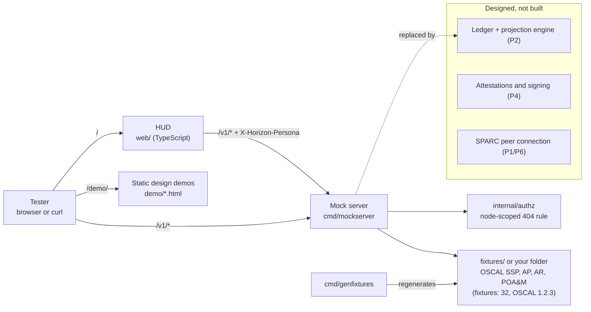

# SPARC Horizon

A heads-up display for authorization risk. Horizon shows authorizing officials (AO), system owners (SO), and information security officers (ISO) what is ahead of each boundary, and lets them act on the management and operational (M&O) controls that automation cannot cover.

Horizon sits on SPARC's Delivery layer. SPARC stays authoritative for pipeline translation, framework crosswalks, and the federation trust fabric. Horizon owns the human side: attestations, AO decisions, forward projections, and the HUD.

> **Status:** working prototype. "SPARC Horizon" is a working name. What runs today is the HUD and
> API v0's read endpoints, served from one container over a synthetic fixture federation in OSCAL
> 1.2.3 or over a folder of your own OSCAL. The ledger, the projection engine, attestation signing and the SPARC connection are
> designed and not built yet: see the [roadmap](docs/roadmap.md).

## What runs today



Everything in the box on the left is in this repository and runs with nothing else installed. The
mock computes every response from the OSCAL documents it is given, at the horizon a request asks
for, and answers the write endpoints with 501; the persona header stands in for a login. Point it at
your own SSP, assessment results and POA&M with `-dir` ([tester guide, section 7](docs/testing.md#7-bring-your-own-oscal)) and the HUD draws them, or pull them from a SPARC instance with `cmd/sparcpull` ([section 8](docs/testing.md#8-pull-from-a-sparc-instance)). **To try it, follow [the tester guide](docs/testing.md).**

## Three ways to run it

**1. The demos alone.** Static HTML with synthetic data; nothing to build or install.

```bash
open demo/index.html            # macOS
xdg-open demo/index.html        # Linux
# or: python3 -m http.server 8080 --directory demo, then browse to http://localhost:8080
```

**2. The container** (Docker). The HUD, the demos and API v0 over the fixture federation, in one process:

```bash
docker build -t sparc-horizon:dev .
docker run --rm -p 8080:8080 sparc-horizon:dev
# HUD at http://localhost:8080/, demos at /demo/, API at /v1/
# your own OSCAL: add -v "$PWD/my-oscal:/data:ro" and see docs/testing.md section 7
curl -s -H 'X-Horizon-Persona: so-ods-portal' http://localhost:8080/v1/tree
```

**3. From source** (Go 1.27, Node 22.18+). The same server without the image, for changing it:

```bash
(cd web && npm ci --ignore-scripts && npm run build)
go run ./cmd/mockserver -static web/dist -demo demo   # same as the container, on 127.0.0.1:8080
(cd web && npm run dev)                # or the HUD with live reload on :5173, proxied to :8080
go run ./cmd/genfixtures               # rewrites fixtures/ wholesale; never edit it by hand
go test ./...                          # includes the regeneration-stability check
```

Personas are in [`fixtures/api/personas.json`](fixtures/api/personas.json); with no header the first one is
used. See [`docs/08-build-deploy.md`](docs/08-build-deploy.md) for how the image is built and released.

| Page | What it shows |
|---|---|
| `web/` → `/` | **The HUD over the API.** Persona picker, breadcrumb tree, heatmap with nominal families collapsed, cell drill, next best action, the OSCAL evidence chain, a horizon date and look-ahead, and hash-verified export. WCAG 2.2 AA in both themes, checked in CI |
| [`demo/hud.html`](demo/hud.html) | Tiered heatmap (federation, organization, boundary, system), look-ahead slider, drill-in to the OSCAL evidence chain, what-if attestations, and an 800-53 or KSI column axis |
| [`demo/planner.html`](demo/planner.html) | Adjustable phase schedule: team size, start date, buffer, scope, and per-phase effort |
| [`demo/full-plan.html`](demo/full-plan.html) | Both demos plus the full design on a single page |

Fonts load from Google Fonts when online and fall back to system fonts offline. Planner settings persist in the browser's `localStorage`.

## Documentation

| Doc | Covers |
|---|---|
| [Tester guide](docs/testing.md) | **Start here to try it:** run it, walk each persona, what is mocked, how to report |
| [01 Scope](docs/01-scope.md) | The claim the prototype proves, what is in and out |
| [02 Architecture](docs/02-architecture.md) | Layers, components, repository layout, dependencies |
| [03 Data model](docs/03-data-model.md) | Tier-to-OSCAL mapping, namespace contract, evidence chain, UUIDs, inheritance |
| [04 API](docs/04-api.md) | API v0 endpoints and response shapes ([`api/openapi.yaml`](api/openapi.yaml)) |
| [05 Projection engine](docs/05-projection-engine.md) | State at any date, rollups, cell rules, next-best-action ranking |
| [06 Attestation workflow](docs/06-attestation-workflow.md) | M&O lifecycle, `saf attest` round trip, AO decisions |
| [07 Security](docs/07-security.md) | Identity, node-scoped authorization, integrity, federation |
| [08 Build and deploy](docs/08-build-deploy.md) | Container, configuration, Terraform |
| [09 Acceptance](docs/09-acceptance.md) | Acceptance criteria and pilot demo script |
| [10 Risks and decisions](docs/10-risks-decisions.md) | Risks, mitigations, and phase 0 decisions |
| [Roadmap](docs/roadmap.md) | Phase plan with tasks, exit criteria, and a default schedule |
| [Contributing](CONTRIBUTING.md) | How a change goes from issue to signed release |
| [Compliance](docs/compliance/README.md) | Horizon's own control story: the 800-53 mapping, its OSCAL component definitions, and the threat model attestation |

Machine-readable contracts:

- [`schemas/sparc-namespace-props.v1.schema.json`](schemas/sparc-namespace-props.v1.schema.json): the namespace props Horizon depends on
- [`api/openapi.yaml`](api/openapi.yaml): API v0 skeleton
- [`docs/compliance/oscal/cdefs/`](docs/compliance/oscal/cdefs/): OSCAL 1.2.x component definitions for Horizon itself
- The key grammar, its field lists and the vectors all three runtimes assert against live in
  `sparc:lib/federation/key-grammar.v1.json` (`sparc#1161`). Horizon consumes that file — vendored
  into `internal/keys/testdata/` with its provenance — rather than publishing its own

The fixture federation itself — four organizations, seven authorization boundaries, twenty
systems, OSCAL 1.2.3 — is generated into [`fixtures/`](fixtures/README.md) by `go run ./cmd/genfixtures`.

## Placeholders to replace

- ~~The namespace URI `https://risk-sentinel.org/ns/sparc` is illustrative.~~ **Registered**
  (`sparc#1155`): the namespace is `https://sparc.risk-sentinel.org/ns`, SPARC's, adopted here
  in #54. The federation namespace UUID `9f434272-f796-589b-b972-954790395630` derives from it,
  so any peer recomputes it rather than copying a constant. The fixtures derive under it and
  their identifiers are final.
- The KSI theme mapping in the demo is illustrative; real mappings come from SPARC.
- ~~`go-oscal` coverage of OSCAL 1.2.x is a phase 0 decision, not an assumption.~~ **Decided
  (#26): `go-oscal`, pinned.** The fixtures are emitted through its `oscal-1-2-3` types and
  validated against the 1.2.3 schema in `go test` (#115; 1.2.2 before).
