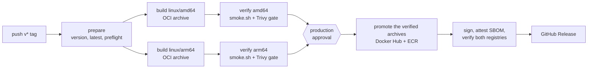

# 08 Build and deploy

## Container

```dockerfile
FROM registry.access.redhat.com/ubi10/nodejs-22-minimal AS web
WORKDIR /opt/app-root/src
COPY web/ .
RUN npm ci --ignore-scripts && npm run build

FROM golang:1.27 AS build
WORKDIR /src
COPY . .
COPY --from=web /opt/app-root/src/dist ./web/dist
RUN CGO_ENABLED=0 go build -trimpath -ldflags="-s -w" -o /horizon ./cmd/horizon

FROM registry.access.redhat.com/ubi10/ubi AS rootfs
RUN dnf --installroot=/rootfs --releasever=10 --setopt=install_weak_deps=False \
      --setopt=tsflags=nodocs,noscripts -y install filesystem redhat-release setup tzdata \
    && dnf --installroot=/rootfs --releasever=10 clean all
# plus the CA bundle and the BaseOS content sets, copied as files

FROM scratch
COPY --from=rootfs /rootfs/ /
COPY --from=build /horizon /usr/local/bin/horizon
USER 1001:1001
ENTRYPOINT ["/usr/local/bin/horizon", "serve"]
```

The root filesystem is built from Red Hat's signed UBI 10 packages, the same lineage as `sparc`'s image, and
holds only four of them: `filesystem`, `redhat-release`, `setup` and `tzdata`. There is no shell, no utility
and no shared library, so the service is the only program in the image, and it runs as uid 1001. The rpm
database lists exactly those four packages, so a scanner reports only what is present. Two files are copied
in rather than installed:

- the CA bundle, because the `ca-certificates` package would pull in `bash`, `coreutils` and 35 more;
- the content sets (`/usr/share/buildinfo/content-sets.json`): the two BaseOS repositories for the image's
  architecture, which scanners use to map the packages to Red Hat advisories. Without it Trivy fails with "unable to find CPE indices".

The repository's `Dockerfile` builds this shape today (#108), with the builders and package versions pinned. Until
`cmd/horizon` exists it builds `cmd/mockserver` instead, and copies in the fixture federation, the HUD built from
`web/` (#122) and the static design demos, read-only for every user (`chmod -R u=rwX,go=rX` in the build stage)
whatever modes the build context carries: `cmd/genfixtures` writes new files `0600`, which uid 1001 could not read
(#117). The HUD's build stage is UBI 10's Node.js 22 minimal image, pinned by digest, installing from the lockfile with
install scripts off; it is never shipped, only its `dist/` is. `cmd/horizon` will embed `dist/` with `go:embed`; the
mock serves it from a directory instead.

```bash
docker build -t sparc-horizon:dev .
docker run --rm -p 8080:8080 sparc-horizon:dev
# HUD at http://localhost:8080/, demos at /demo/, API v0 at /v1/
# (persona header: X-Horizon-Persona, see fixtures/api/personas.json)
```

| Flag | Default in the image | What it serves |
|---|---|---|
| `-dir` | `/srv/horizon/fixtures` | The OSCAL documents every response is computed from. Mount your own read-only and point this at it |
| `-static` | `/srv/horizon/web` | The HUD, at `/` |
| `-demo` | `/srv/horizon/demo` | The static design demos, at `/demo/` |
| `-horizon` | `2026-10-15` | The default projection date; today when empty |
| `-role-alias` | none | Maps a document's role-id onto a contract role, repeatable |

Arguments after the image name replace the whole default command, so a `docker run` that adds `-dir` repeats
`-static` and `-demo` (the tester guide's commands do).

**Content-Security-Policy, per surface (#122).** Every response carries one, with `nosniff` and
`Referrer-Policy: no-referrer`:

| Surface | Policy | Why |
|---|---|---|
| `/` the HUD | `default-src 'none'; script-src 'self'; style-src 'self'; img-src 'self' data:; font-src 'self'; connect-src 'self'; base-uri 'none'; form-action 'none'; frame-ancestors 'none'` | It draws strings from other parties' documents, so nothing inline runs and it talks only to its own origin. CI fails on any violation |
| `/v1/`, `/oscal/`, `/mock/`, `/healthz` | `default-src 'none'; frame-ancestors 'none'` | JSON no browser should execute or frame |
| `/demo/` | Allows inline script and style, and Google Fonts | The throwaway single-file demos need them; the looser policy never reaches `/` |

## Release

`.github/workflows/build-sign-publish.yml` publishes the image to Docker Hub (`risksentinel/sparc-horizon`) and
Amazon ECR (`sparc-horizon`), modelled on `sparc`'s pipeline (#113). Nothing reaches a registry until the exact bytes
that will ship have been built, run and scanned on both architectures and the release has been approved, so a
failure before the approval spends no tag.



| Stage | What it proves |
|---|---|
| `prepare` | The version is `vX.Y.Z[-pre]`; a real release has its credentials, and the Docker Hub repository exists, before anything is built |
| `verify` (per arch) | The archive that will ship runs: `tests/container-smoke/smoke.sh`, the same checks as every PR. Trivy finds no CRITICAL or HIGH that `container-baseline.yml` hasn't dispositioned, and it identified the OS and inventoried packages |
| `production` | The single human approval. Everything before it is automatic; nothing after it rebuilds |
| promote | The verified bytes, not a rebuild, go up under transient `stage-` tags and are joined into the release tags. Docker Hub gets `vX.Y.Z`, `vX.Y`, `vX` and `latest` (see below); ECR gets `vX.Y.Z` only |
| sign | Sigstore keyless, identity limited to this workflow at a `v*` tag; a CycloneDX SBOM is attested. Both are verified in both registries |

**One-time setup, before the first release:**

- the ECR repository and the `SPARC_HORIZON_PUBLISH_ARN` role (sparc-iac#856), set as a repository secret;
- the Docker Hub repository `risksentinel/sparc-horizon`;
- required reviewers on the `production` environment (Settings → Environments). Without them, the approval gate
  approves itself;
- optionally, the `HORIZON_LATEST_MAJOR` repository variable. `latest` moves only for the highest full release of
  that major line, and never while it is unset.

**Dry run:** every pull request that touches the release path (the workflow, `Dockerfile`, `container-baseline.yml`,
the baseline tool or the smoke script) runs the whole pipeline up to the approval, and so does Actions → Build,
Sign & Publish → Run workflow. A dry run stops after the two verify jobs: it needs no credentials and no approval.

**Release:** push a signed tag, for example `git tag -s v0.1.0 -m v0.1.0 && git push origin v0.1.0`, then approve
the `production` deployment once both verify jobs are green.

**Verify a published image:**

```bash
cosign verify \
  --certificate-identity-regexp '^https://github\.com/risk-sentinel/sparc-horizon/\.github/workflows/build-sign-publish\.yml@refs/tags/v' \
  --certificate-oidc-issuer https://token.actions.githubusercontent.com \
  risksentinel/sparc-horizon@sha256:<digest>
```

A CRITICAL or HIGH finding that can't be fixed is recorded in `container-baseline.yml` with a rationale, a NIST
control, a reviewer and a review date. That is an owner decision (`docs/dev/issue_rules.md`, "Suppressing scanner
findings"), and an entry past its review date fails the release until it's re-reviewed.

## Configuration

| Variable | Default | Purpose |
|---|---|---|
| `HORIZON_SPARC_URL` | none | SPARC Delivery API |
| `HORIZON_SPARC_CA` | none | CA bundle for mTLS |
| `HORIZON_OIDC_ISSUER` | none | Agency IdP issuer URL |
| `HORIZON_DB_DSN` | `sqlite:///data/horizon.db` | Ledger and projections |
| `HORIZON_EVIDENCE_URI` | none | Object store for evidence |
| `HORIZON_SIGNING_CERT` | none | PKI certificate and key reference |
| `HORIZON_BUCKETS` | `0,7,14,30` | Projection horizons in days |
| `HORIZON_NAMESPACE` | `https://sparc.risk-sentinel.org/ns` | Namespace contract |

## Terraform

```hcl
module "horizon" {
  source          = "./deploy/terraform/horizon"
  image           = "registry.example.gov/horizon:0.1.0"
  sparc_url       = var.sparc_url
  oidc_issuer     = var.oidc_issuer
  evidence_bucket = aws_s3_bucket.evidence.id
}
```

A Helm chart under `deploy/helm/` covers Kubernetes targets with the same variables.
